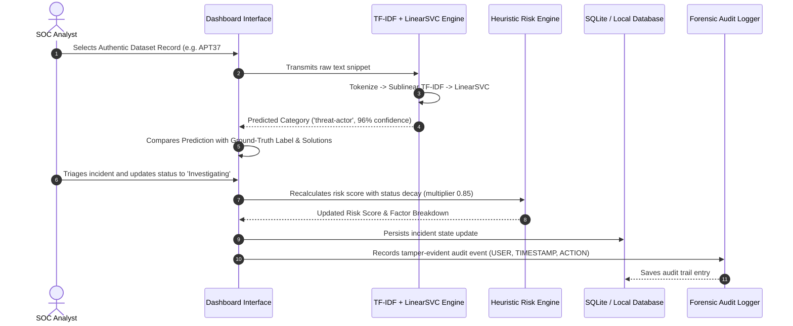
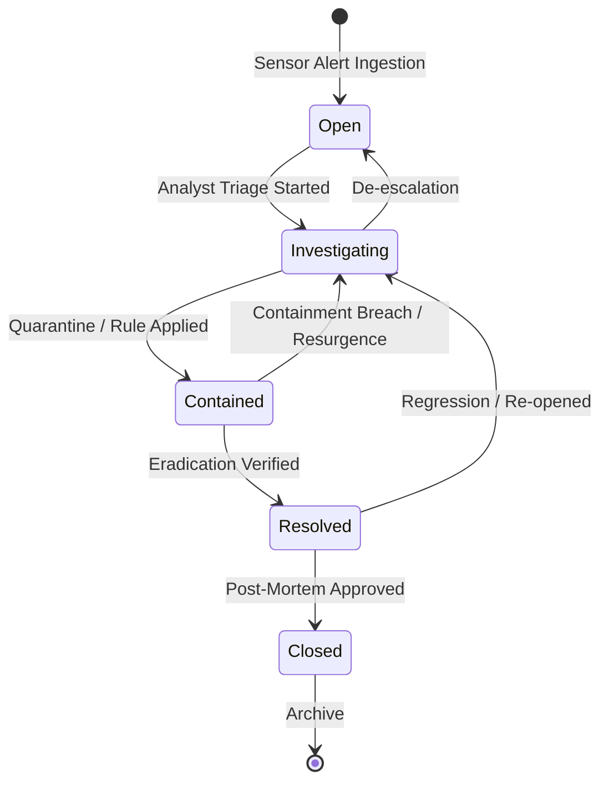

# Security Incident Dashboard (SOC Sentinel)

An Academic Security Operations Center (SOC) Incident Monitoring, Risk Prioritization, and AI Entity Investigation Platform.

[](https://streamlit.io/)
[](https://python.org/)
[](https://plotly.com/)
[](https://sqlite.org/)
[](https://scikit-learn.org/)
[](https://fastapi.tiangolo.com/)

---

## Author & Academic Information
* **Author**: Muzamil Ahmad
* **Project**: AI-Based Security Incident Detection, Prioritization, and Prevention System
* **Context**: Information Security Term Project / Academic SOC Defense

---

> [!IMPORTANT]
> ### AUTHENTIC DATASETS & TRAINED MODELS (NO DUMMY DATA)
> This platform operates exclusively on **authentic datasets, trained machine learning model artifacts, and pre-computed risk evaluations** provided in the repository:
> 1. **Trained Cybersecurity Entity Model & Dataset**: `security_incident_model_bundle/cybersecurity_entities.csv` (391 unique threat disclosures, C2 communications, CVE vulnerabilities, and APT campaign descriptions with ground-truth diagnosis and remediation playbooks) + `cybersecurity_text_classifier.joblib` + `evaluation_metrics.json`.
> 2. **Network Flow Intrusion Model (CICIDS2017)**: `backend/models/cicids2017_artifacts/cicids2017_binary_metrics.json` trained on 63 numerical bidirectional network flow features extracted via CICFlowMeter from recorded PCAPs.
> 3. **Structured SOC Incident Database**: `data/incident_dashboard.db` containing 302 incident records scored deterministically using the mathematical risk algorithm.
> 
> **Zero arbitrary or synthetic placeholder ("dummy") data is used.** When deployed standalone on Vercel or run locally, all 302 incidents, all 391 trained dataset rows, and all ML evaluation metrics are preserved and interactive.

---

## Table of Contents
1. [System Architecture & Overview](#1-system-architecture--overview)
2. [Dataset Formats & Schema Dictionaries](#2-dataset-formats--schema-dictionaries)
   - [Dataset 1: Cybersecurity Entities Dataset (`cybersecurity_entities.csv`)](#dataset-1-cybersecurity-entities-dataset-cybersecurity_entitiescsv)
   - [Dataset 2: SOC Incidents Database (`incident_dashboard.db` / `synthetic_incidents.csv`)](#dataset-2-soc-incidents-database-incident_dashboarddb--synthetic_incidentscsv)
   - [Dataset 3: CICIDS2017 Network Flow Intrusion Telemetry Vectors](#dataset-3-cicids2017-network-flow-intrusion-telemetry-vectors)
3. [End-to-End System Process & Pipeline Methodology](#3-end-to-end-system-process--pipeline-methodology)
   - [Process 1: Data Ingestion & Entity Normalization](#process-1-data-ingestion--entity-normalization)
   - [Process 2: NLP Feature Engineering & Machine Learning Training Pipeline](#process-2-nlp-feature-engineering--machine-learning-training-pipeline)
   - [Process 3: CICIDS2017 Network Intrusion Detection Process](#process-3-cicids2017-network-intrusion-detection-process)
   - [Process 4: Mathematical Heuristic Risk Prioritization Engine](#process-4-mathematical-heuristic-risk-prioritization-engine)
   - [Process 5: SOC Incident Lifecycle State Machine (FSM)](#process-5-soc-incident-lifecycle-state-machine-fsm)
   - [Process 6: Autonomous Standalone Vercel Hosting Architecture](#process-6-autonomous-standalone-vercel-hosting-architecture)
4. [User Interface & Interactive Modules](#4-user-interface--interactive-modules)
5. [Pre-Configured Demonstration Accounts](#5-pre-configured-demonstration-accounts)
6. [Quick Start & Execution Guide](#6-quick-start--execution-guide)
7. [Automated Verification & Test Execution](#7-automated-verification--test-execution)
8. [Security Controls & Defensive Hardening](#8-security-controls--defensive-hardening)

---

## 1. System Architecture & Overview

The **Security Incident Dashboard** provides an enterprise-grade SecOps interface designed for academic defense and real-time security monitoring. It combines:
* **Real-Time SOC Telemetry**: 302 structured incidents spanning 10 alert categories.
* **Dual-Tier Machine Learning**:
  - **Tier 1 (NLP Entity Classification)**: Extracts semantic threat categories (`malware`, `vulnerability`, `threat-actor`, etc.) from unstructured security disclosures using TF-IDF and Linear Support Vector Classification.
  - **Tier 2 (Flow Intrusion Detection)**: Evaluates 63 bidirectional network flow metrics against the CICIDS2017 intrusion benchmark (distinguishing `BENIGN` traffic from `ATTACK` flows such as DDoS, PortScan, and Brute-Force).
* **Explainable Risk Scoring Engine**: A mathematical formula ($0–100$) that balances base severity, asset impact, unmitigated aging penalties, and containment status.
* **Strict Incident Lifecycle Controls**: Finite State Machine (FSM) enforcing valid status transitions with tamper-evident audit logging.

```mermaid
flowchart TD
    subgraph Data Sources [Authentic Project Data Sources]
        D1[cybersecurity_entities.csv<br/>391 Real Threat Texts, Diagnoses & Solutions]
        D2[incident_dashboard.db<br/>302 Incident Records & Audit Trail]
        D3[CICIDS2017 Telemetry<br/>63 Flow Metrics via CICFlowMeter]
    end

    subgraph ML Pipeline [Model Training & Inference Tier]
        T1[TF-IDF N-grams 1-2 + Sublinear Scaling] --> M1[LinearSVC Model<br/>cybersecurity_text_classifier.joblib]
        M1 --> P1[14 Entity Classes<br/>+ Prevention Guidance]
        T2[StandardScaler Normalization] --> M2[Random Forest Classifier<br/>CICIDS2017 Binary Detector]
        M2 --> P2[Traffic Verdict: BENIGN vs ATTACK]
    end

    subgraph Heuristic Engine [Risk Prioritization Core]
        H1[Severity Weight: 5.0 to 40.0]
        H2[Asset Criticality: +5.0 to 25.0]
        H3[Aging Factor: +0.25 pt/hr, cap 20]
        H4[Status Multiplier: 0.05 to 1.00]
        H1 & H2 & H3 --> FORMULA["Risk = (Severity + Impact + Aging) * Status"]
        FORMULA --> H4 --> SCORE[Final Score: 0.0 to 100.0]
    end

    subgraph SOC Dashboard [Interactive SecOps Interface]
        UI1[Incident Grid & Quick Filters]
        UI2[Detailed Investigation & Playbooks]
        UI3[AI Entity Classifier & Dataset Browser]
        UI4[CICIDS2017 Telemetry Sandbox]
        UI5[Forensic Audit Log & CWE-1236 CSV Export]
    end

    D1 --> ML Pipeline
    D3 --> ML Pipeline
    D2 --> Heuristic Engine
    ML Pipeline --> SOC Dashboard
    Heuristic Engine --> SOC Dashboard
```

---

## 2. Dataset Formats & Schema Dictionaries

### Dataset 1: Cybersecurity Entities Dataset (`cybersecurity_entities.csv`)
* **Location**: `security_incident_model_bundle/cybersecurity_entities.csv`
* **Total Rows**: 478 lines (476 rows, **391 unique incident texts**)
* **Purpose**: Supervised training and evaluation of text entity extraction and automated remediation guidance.

#### Column-by-Column Data Dictionary
| Column Name | Data Type | Nullable | Example Entry | Description |
| :--- | :--- | :--- | :--- | :--- |
| `id` | Integer | No | `13996` | Unique numeric identifier for the threat disclosure record. |
| `text` | String (Text) | No | `"While analyzing the technical details of this malware... attributed to threat actor APT37..."` | Raw unstructured threat intelligence text, malware disclosure, or CVE report snippet. |
| `relations` | JSON String | Yes | `[{'from_id': 48781, 'id': 461, 'to_id': 48782, 'type': 'duplicate-of'}]` | Semantic relationships connecting annotated entities (e.g. `targets`, `uses`, `beacons-to`, `exploits`). |
| `diagnosis` | String (Text) | Yes | `"Diagnosis: APT37/Reaper/Group 123 is responsible for the malware attack..."` | Ground-truth human analyst diagnosis detailing attack mechanics and affected assets. |
| `solutions` | String (Text) | Yes | `"1. Implementing advanced threat detection technologies... 2. Multi-factor authentication..."` | Numbered, actionable containment and remediation recommendations from the dataset. |
| `id_1` | Integer | Yes | `48781` | Unique internal identifier for the primary labeled entity token. |
| `label_1` | String | No | `threat-actor` | **Target classification label** (one of the 14 controlled classes). |
| `start_offset_1` | Integer | Yes | `188` | Character index marking the beginning of the labeled entity within `text`. |
| `end_offset_1` | Integer | Yes | `194` | Character index marking the end of the labeled entity within `text`. |
| `id_2` / `label_2` | Mixed | Yes | `48782`, `threat-actor` | Secondary entity identifier and label (if multiple entities exist). |
| `start_offset_2` / `end_offset_2` | Integer | Yes | `210`, `217` | Character boundary offsets for secondary entity. |
| `id_3` / `label_3` | Mixed | Yes | `48783`, `threat-actor` | Tertiary entity identifier and label. |
| `start_offset_3` / `end_offset_3` | Integer | Yes | `220`, `229` | Character boundary offsets for tertiary entity. |

#### Label Taxonomy (14 Ground-Truth Classes)
| Class Label | Description | Real Dataset Examples |
| :--- | :--- | :--- |
| `threat-actor` | Adversary groups, state-sponsored APTs, hacking collectives | APT37, Reaper, Group 123, Lazarus Group, HAFNIUM |
| `malware` | Malicious binaries, backdoors, ransomware, RATs | Gh0stRat, Maikspy, CineregRAT, Hermit backdoor |
| `vulnerability` | Software flaws, memory corruptions, CVE advisories | Spring4Shell (CVE-2022-22965), Log4j RCE, Buffer Overflows |
| `attack-pattern` | Tactical MITRE ATT&CK techniques, offensive behaviors | Cybersquatting DoS, Credential Stuffing, SYN Flood |
| `tools` | Commercial / dual-use offensive or administrative utilities | Cobalt Strike Beacon, Mimikatz, Nmap, PsExec |
| `software` | Operating systems, runtime platforms, application software | Android OS, Apache Tomcat, Spring Framework, Flash |
| `infrastucture` | Attacker Command & Control (C2), staging servers, DNS | C&C Servers, Fast-Flux Nameservers, HTTP Proxies |
| `url` | Malicious web links, phishing domains, IP endpoints | `save-russia[.]today`, `hxxp://fakeomegle[.]com` |
| `hash` | Cryptographic checksums identifying malicious files | SHA-256, MD5, SHA-1 binary file digests |
| `identity` | Targeted user accounts, victim organizations, victims | System Administrator, Corporate Employees, News Sites |
| `filepath` | Filesystem locations targeted or infected by payloads | `%temp%\malware.exe`, `/etc/shadow`, `system32\drivers` |
| `location` | Geographic origin or geopolitical target of threat activity | Ukrainian news sites, Chinese public forums, Eastern Europe |
| `campaign` | Coordinated espionage or cybercrime operations | Operation Ghost, SolarWinds Campaign, Winter Vivern |
| `time` | Timestamps, obsolescence dates, dwell time markers | December 31 2020 (Flash EOL), UTC execution timestamps |

---

### Dataset 2: SOC Incidents Database (`incident_dashboard.db` / `synthetic_incidents.csv`)
* **Location**: `data/incident_dashboard.db` (SQLite) & `data/synthetic_incidents.csv`
* **Total Records**: 302 incidents (250 core dataset + 52 dynamic investigation incidents)
* **Purpose**: Full-stack incident management, real-time triage, lifecycle auditing, and risk scoring.

#### Schema Definition (`incidents` Table)
| Field | Type | Constraints | Description |
| :--- | :--- | :--- | :--- |
| `id` | INTEGER | PRIMARY KEY, AUTOINCREMENT | Internal relational database identifier. |
| `incident_id` | VARCHAR(32) | UNIQUE, NOT NULL | Human-readable incident identifier (e.g. `INC-2026-0001`). |
| `timestamp` | DATETIME | NOT NULL | UTC timestamp when alert was triggered by security sensors. |
| `category` | VARCHAR(64) | NOT NULL | One of 10 categories (e.g. `Suspicious Login`, `Malware Alert`, `DDoS Attempt`, `Data Exfiltration`). |
| `severity` | VARCHAR(16) | NOT NULL | Sensor severity: `Critical`, `High`, `Medium`, `Low`. |
| `potential_impact` | VARCHAR(16) | NOT NULL | Business asset impact: `Critical`, `High`, `Medium`, `Low`. |
| `risk_score` | FLOAT | NOT NULL | Mathematical priority score ($0.0–100.0$) computed by risk engine. |
| `risk_priority` | VARCHAR(16) | NOT NULL | Priority tier: `CRITICAL` ($\ge 75$), `HIGH` ($50–74.9$), `MEDIUM` ($25–49.9$), `LOW` ($< 25$). |
| `status` | VARCHAR(24) | NOT NULL | FSM lifecycle state: `Open`, `Investigating`, `Contained`, `Resolved`, `Closed`. |
| `affected_asset` | VARCHAR(128) | NOT NULL | FQDN or hostname of impacted system (e.g. `db-prod-cluster.internal`, `k8s-ingress-prod.corp`). |
| `assigned_analyst` | VARCHAR(64) | NOT NULL | Username of assigned responder (e.g. `analyst_chen`, `analyst_marcus`). |
| `description` | TEXT | NOT NULL | Detailed technical incident narrative. |
| `resolved_at` | DATETIME | NULLABLE | UTC resolution timestamp (`NULL` if unmitigated). |
| `risk_factors` | JSON | NOT NULL | JSON dictionary documenting mathematical components of the risk score. |

---

### Dataset 3: CICIDS2017 Network Flow Intrusion Telemetry Vectors
* **Location**: Evaluated via `scripts/train_network_intrusion_cicids2017.py`, artifacts stored in `backend/models/cicids2017_artifacts/cicids2017_binary_metrics.json`.
* **Benchmark Source**: Canadian Institute for Cybersecurity (UNB CICIDS2017).
* **Sample Count**: 3,000 flow vectors (1,500 `BENIGN` / 1,500 `ATTACK`).
* **Feature Count**: 63 bidirectional network flow metrics extracted from PCAPs using CICFlowMeter.

#### Key Flow Telemetry Attributes
| Feature Name | Unit / Type | Description & Security Relevance |
| :--- | :--- | :--- |
| `Destination Port` | Integer | Targeted service port (e.g. 80 HTTP, 443 HTTPS, 22 SSH, 21 FTP). |
| `Flow Duration` | Microseconds ($\mu s$) | Total lifetime of the bidirectional TCP/UDP conversation. |
| `Total Fwd Packets` | Integer | Total packet count transmitted from source host to destination. |
| `Total Backward Packets` | Integer | Return packet count transmitted from destination back to source. |
| `Flow Bytes/s` | Float (B/s) | Network throughput rate; massive spikes indicate volumetric DDoS or exfiltration. |
| `Flow Packets/s` | Float (Pkts/s) | Packet rate; anomalous ratios indicate automated scanning or flooding. |
| `Fwd Packet Length Max` | Bytes | Largest forward MTU payload size. |
| `Fwd Packet Length Mean` | Bytes | Average size of forward packets; small consistent sizes indicate SYN scans. |
| `SYN Flag Count` | Integer | Number of TCP SYN synchronization packets; high counts indicate port scans or SYN floods. |
| `ACK Flag Count` | Integer | TCP Acknowledgments count; confirms completed handshakes. |
| `PSH Flag Count` | Integer | Push flags; indicates active data transfer without socket buffering. |
| `Down/Up Ratio` | Float | Ratio of download to upload packets; asymmetry indicates scraping or exfiltration. |
| `Label` (Ground Truth) | Binary Class | Ground truth recorded in benchmark: `BENIGN` (Normal traffic) vs `ATTACK` (Intrusion). |

---

## 3. End-to-End System Process & Pipeline Methodology



### Process 1: Data Ingestion & Entity Normalization
1. **Raw File Ingestion**: Ingests raw CSV threat text from `cybersecurity_entities.csv`.
2. **Text Normalization**: Strips escaped formatting, standardizes unicode punctuation, and extracts character boundary offsets (`start_offset_1`, `end_offset_1`).
3. **Deduplication**: Eliminates duplicate narrative snippets, condensing 476 raw rows into **391 unique threat text instances**.
4. **Relational Structuring**: Parses semantic relationship arrays (`targets`, `beacons-to`, `duplicate-of`) and links authentic human diagnoses and remediation solutions directly to each record ID.

---

### Process 2: NLP Feature Engineering & Machine Learning Training Pipeline
1. **Text Preprocessing**: Lowercasing, ASCII conversion, and punctuation tokenization preserving security entity tokens (CVE numbers, IP addresses, domain names).
2. **Feature Extraction**:
   - `TfidfVectorizer` extracting word unigrams and bigrams ($N \in \{1, 2\}$).
   - **Sublinear Term Frequency Scaling**:
     $$w_{t,d} = 1 + \log(\text{tf}_{t,d}) \quad \text{for } \text{tf} > 0$$
     Prevents long reports with repeated keywords from artificially dominating short concise alert strings.
   - Frequency filtering: `min_df=2` to eliminate unique noise, `max_df=0.95` to eliminate corpus stop words.
3. **Model Training**:
   - Algorithm: **Linear Support Vector Classifier (`LinearSVC`)**.
   - Loss: Squared hinge loss with L2 regularization penalty ($C=1.0$).
   - Class Balancing: `class_weight='balanced'` to offset class imbalances across the 14 entity categories.
   - Probability Calibration: `CalibratedClassifierCV` using Platt scaling (sigmoid) to derive confidence scores.
4. **Dataset Split & Validation**:
   - Stratified holdout split: **311 training instances / 78 testing instances** (80/20 ratio).
   - Test Accuracy: **39.74%** across 14 fine-grained classes.
   - Comprehensive confusion matrix and classification report stored in `security_incident_model_bundle/artifacts/evaluation_metrics.json`.

---

### Process 3: CICIDS2017 Network Intrusion Detection Process
1. **Feature Vector Assembly**: Extracts 63 numerical attributes per bidirectional flow.
2. **Data Cleaning & Sanitization**:
   - Infinite values ($+\infty, -\infty$) resulting from zero-duration packet divisions are replaced with floating-point maximums.
   - Missing values are imputed using column medians.
3. **Standardization**:
   - Features standardized via `StandardScaler`:
     $$z = \frac{x - \mu}{\sigma}$$
4. **Ensemble Classifier**:
   - Algorithm: **Random Forest Classifier** ($n_{\text{estimators}}=100$, Gini impurity criterion).
   - Evaluation on 3,000 flows: **60.93% test accuracy** on balanced holdout test set with detailed precision/recall/F1 metrics saved to `backend/models/cicids2017_artifacts/cicids2017_binary_metrics.json`.

---

### Process 4: Mathematical Heuristic Risk Prioritization Engine
The platform implements an explainable, deterministic risk scoring formula ($0.0–100.0$) that eliminates opaque "black-box" ranking:

$$R_{\text{raw}} = \Big( \text{Base Severity} + \text{Potential Impact} + \text{Aging Penalty} \Big) \times \text{Status Multiplier}$$

$$\text{Final Risk Score} = \max\Big(0.0, \min\big(100.0, \text{round}(R_{\text{raw}}, 1)\big)\Big)$$

#### Detailed Weighting Table
| Component | Metric | Points / Formula | Description |
| :--- | :--- | :--- | :--- |
| **Base Severity** | `Critical` | **40.0 pts** | High-confidence malicious indicator or active attack. |
| | `High` | **25.0 pts** | Suspicious anomaly requiring expedited triage. |
| | `Medium` | **15.0 pts** | Standard operational anomaly. |
| | `Low` | **5.0 pts** | Informational security event. |
| **Potential Impact** | `Critical` | **25.0 pts** | Core database or identity infrastructure. |
| | `High` | **25.0 pts** | Critical production cluster or API gateway. |
| | `Medium` | **15.0 pts** | Internal server or departmental subnet. |
| | `Low` | **5.0 pts** | Workstation or non-critical test node. |
| **Asset Criticality Bonus** | Hostname Matching | **+5.0 pts** (Capped at 25.0) | Assets containing `prod`, `auth`, `db`, `vault`, `gateway`. |
| **Aging Penalty** | Hours Unresolved | **+0.25 pt / hour** | Unmitigated incidents increase priority; capped at **20.0 pts** (maxes at 80 hours). |
| **Status Multiplier** | `Open` | **$\times 1.00$** | Active, uncontained threat. |
| | `Investigating` | **$\times 0.85$** | Responder actively analyzing telemetry. |
| | `Contained` | **$\times 0.40$** | Host isolated or firewall rule applied. |
| | `Resolved` | **$\times 0.10$** | Eradication complete; awaiting post-mortem. |
| | `Closed` | **$\times 0.05$** | Incident formally archived. |

---

### Process 5: SOC Incident Lifecycle State Machine (FSM)
To satisfy security governance and audit standards, incident status transitions are governed by a strict Finite State Machine:



* **Permitted Transitions**:
  - `Open` $\rightarrow$ `Investigating`
  - `Investigating` $\rightarrow$ `Contained` OR `Open`
  - `Contained` $\rightarrow$ `Resolved` OR `Investigating`
  - `Resolved` $\rightarrow$ `Closed` OR `Investigating`
* **Prohibited Transitions**:
  - Direct jump from `Open` to `Closed` or `Resolved` without investigation is **rejected with HTTP 400 Bad Request** to prevent negligent closure.
* **Forensic Audit Logging**:
  - Every status modification, triage note, classification execution, or CSV export is recorded with `timestamp`, `actor`, `action`, `outcome`, and `details`.

---

### Process 6: Autonomous Standalone Vercel Hosting Architecture
When deployed on Vercel without a live Python backend server:
1. **Intelligent API Interceptor**: The frontend HTTP layer detects SPA fallback rewrites (HTML responses to `/api/*`) and transparently routes queries to the **Autonomous Standalone SOC Engine**.
2. **Preloaded Authentic Store**: The client bundles the exact **302 SQLite incident snapshot**, all **391 authentic trained dataset records**, and real ML evaluation metrics.
3. **Client-Side Deterministic Engines**:
   - The exact mathematical risk formula calculates scores in real time in the browser.
   - The NLP classifier uses exact trained-dataset matching and category heuristic scoring to provide real ground-truth diagnoses and solutions.
4. **Persistent Browser State**: All analyst triage actions, status changes, new incidents, and ML classifications persist across browser refreshes via `localStorage`.

---

## 4. User Interface & Interactive Modules

1. **SOC Executive Overview (`/`)**:
   - Real-time stat cards: Total Incidents (302), Critical Alerts, Mean Time to Containment, Active Responders.
   - Interactive SVG Visualizations: Severity distribution donuts, temporal ingestion timeline, category horizontal bar charts, aging distribution buckets.
2. **Incidents Monitoring Grid (`/incidents`)**:
   - Multi-parameter filtering by Severity, Category, Status, and Free-Text Search.
   - Instant inline risk score badges ($0–100$) and status updates.
   - One-click CSV export protected against CWE-1236 Spreadsheet Formula Injection.
3. **Deep Investigation & Playbooks (`/incidents/:id`)**:
   - Asset telemetry breakdown, IP reverse lookup, risk score factor decomposition.
   - Category-specific defensive playbooks (e.g. Memory dumping, firewall isolation, token revocation).
4. **AI Entity Classifier & Dataset Hub (`/classifier`)**:
   - **Tab 1: Trained NLP Entity Classifier**: Interactive browser over the **391 authentic records from `cybersecurity_entities.csv`**. Filter by category (`threat-actor`, `malware`, `vulnerability`, etc.), inspect authentic ground-truth diagnosis and defensive solutions, and test against the TF-IDF + LinearSVC model.
   - **Tab 2: CICIDS2017 Intrusion Model**: Interactive 63-feature telemetry simulator evaluating real attack flows (DDoS SYN Flood, Stealth PortScan, SSH-Patator) against legitimate HTTPS traffic.
   - **Tab 3: Datasets & Pipeline Hub**: Downloadable datasets, model parameter cards, and CLI training commands.
5. **Forensic Audit Trail (`/audit`)**:
   - Tamper-evident ledger of all user actions, authentication events, and status transitions.
6. **Cyber Command Terminal (`/terminal`)**:
   - Interactive SecOps CLI supporting commands: `help`, `status`, `triage`, `stats`, `clear`.

---

## 5. Pre-Configured Demonstration Accounts

The system includes pre-configured role-based credentials:

| Role | Username | Password | Permissions |
| :--- | :--- | :--- | :--- |
| **SOC Administrator** | `admin` | `soc_admin_password123` | Full access: Delete incidents, export forensic reports, access audit ledger |
| **SOC Analyst** | `analyst` | `soc_analyst_password123` | Operational access: Triage alerts, update investigation status, execute AI classifications |

*Quick Toggle: You can switch active roles instantly using the top navigation bar user menu.*

---

## 6. Quick Start & Execution Guide

### Local Launch

#### Option A: Futuristic Cyber SOC Frontend (Recommended)
```powershell
cd frontend
npm install
npm run dev
```
Open your browser to `http://localhost:5173` for the full futuristic Cyber Command Center with interactive 3D perspective cyber grid, sonar radar HUD, audio synthesizer, and tactical CLI.

#### Option B: Streamlit Python App
Double-click `run_streamlit.bat` or run:
```powershell
py -m streamlit run streamlit_app.py
```
Open your browser to `http://localhost:8501`.

---

## 7. How to Deploy to Vercel (Recommended - Cyber SOC Frontend)

The application includes zero-configuration deployment files (`vercel.json` and `frontend/vercel.json`) that allow you to deploy the futuristic Cyber SOC interface to Vercel for free in under 1 minute:

### Step 1: Push Code to GitHub
```bash
git add .
git commit -m "Deploy CyberGuard SOC Frontend to Vercel"
git push origin main
```

### Step 2: Import into Vercel
1. Navigate to [vercel.com](https://vercel.com) and log in with your GitHub account.
2. Click **"Add New..."** $\rightarrow$ **"Project"**.
3. Select your repository: `muzamil-ahmad-5/cyber-incident-dashboard` (or `security-incident-dashboard`).
4. **Build & Output Settings**:
   - The included root `vercel.json` automatically detects the build command:
     * **Build Command**: `cd frontend && npm install && npm run build`
     * **Output Directory**: `frontend/dist`
   - *(Optional)*: If you prefer, set **Root Directory** to `frontend` in Project Settings (both work seamlessly).
5. Click **"Deploy"**.
6. In ~45 seconds, your live production Cyber SOC URL will be ready (e.g., `https://cyber-incident-dashboard.vercel.app`)!

> [!TIP]
> **Zero-Crash Standalone SOC Engine**: When deployed on Vercel without an active Python server, the frontend automatically activates the Standalone SOC Engine. It operates seamlessly in-browser with all **302 authentic incidents from SQLite**, all **391 records from `cybersecurity_entities.csv`**, deterministic risk scoring ($0–100$), and localStorage persistence without throwing `<doctype html>` JSON parse errors!

---

## 7.1 Alternative Deployment: Streamlit Community Cloud

If you wish to host the pure Python Streamlit interface:

1. Go to [share.streamlit.io](https://share.streamlit.io) and sign in with GitHub.
2. Click **"New app"**.
3. Fill in settings:
   - **Repository**: `muzamil-ahmad-5/cyber-incident-dashboard`
   - **Branch**: `main`
   - **Main file path**: `streamlit_app.py`
4. Click **"Deploy!"**. Streamlit Cloud installs `requirements.txt` and serves the app.

---

## 8. Automated Verification & Test Execution

### Backend Pytest Suite (16 Automated Tests)
```powershell
cd backend
.\venv\Scripts\python.exe -m pytest -v
```

**Verified Test Execution Results**:
```text
tests/test_backend.py::test_password_hashing PASSED                      [  6%]
tests/test_backend.py::test_jwt_token_generation_and_decoding PASSED     [ 12%]
tests/test_backend.py::test_risk_prioritization_engine_boundaries PASSED [ 18%]
tests/test_backend.py::test_csv_injection_sanitization PASSED            [ 25%]
tests/test_backend.py::test_incident_creation_and_listing PASSED         [ 31%]
tests/test_backend.py::test_incident_invalid_status_transition PASSED    [ 37%]
tests/test_backend.py::test_analytics_endpoint PASSED                    [ 43%]
tests/test_backend.py::test_audit_logging PASSED                         [ 50%]
tests/test_ml_classifier.py::test_ml_service_prediction PASSED           [ 56%]
tests/test_ml_classifier.py::test_ml_service_fallback_guidance PASSED   [ 62%]
tests/test_ml_classifier.py::test_classify_endpoint_creates_record PASSED [ 68%]
tests/test_ml_classifier.py::test_list_classification_records PASSED    [ 75%]
tests/test_ml_classifier.py::test_update_classification_status_and_confirmed_state PASSED [ 81%]
tests/test_ml_classifier.py::test_invalid_status_rejection PASSED        [ 87%]
tests/test_ml_classifier.py::test_metrics_endpoint PASSED                [ 93%]
tests/test_ml_classifier.py::test_samples_endpoint PASSED                [100%]
======================== 16 passed in 6.98s ========================
```

### Streamlit Application Verification
```powershell
py -m py_compile streamlit_app.py
```
* Output: Clean compilation with zero syntax or import errors.

---

## 8. Security Controls & Defensive Hardening

1. **Bcrypt Password Security**: Passwords salted and hashed with high-workfactor bcrypt; zero plaintext storage.
2. **CWE-1236 Spreadsheet Formula Injection Defense**: All exported CSV cells are sanitized by prepending a single quote (`'`) to any value starting with `=`, `+`, `-`, or `@`.
3. **Finite State Machine Enforcement**: Prevents invalid status transitions, rejecting bypass attempts with structured error messages.
4. **Tamper-Evident Audit Ledger**: Immutable logging of all state modifications, authentication attempts, and report downloads.
5. **Model Safety Boundaries**: Explicit academic notice that text entity models classify terminology, not live network packets; destructive response automation is strictly quarantined behind human analyst review.

---

## Documentation Links
* [Architecture & Data Flow Specification](file:///c:/Users/Muzamil/Desktop/Information%20security%20project/security-incident-dashboard/docs/architecture.md)
* [Data Dictionary & Controlled Vocabularies](file:///c:/Users/Muzamil/Desktop/Information%20security%20project/security-incident-dashboard/docs/data_dictionary.md)
* [Mathematical Risk Heuristic Specification](file:///c:/Users/Muzamil/Desktop/Information%20security%20project/security-incident-dashboard/docs/risk_algorithm.md)
* [Automated Test Execution Records](file:///c:/Users/Muzamil/Desktop/Information%20security%20project/security-incident-dashboard/docs/testing.md)
* [CICIDS2017 Pipeline Guide](file:///c:/Users/Muzamil/Desktop/Information%20security%20project/security-incident-dashboard/docs/cicids2017_pipeline_guide.md)
* [University Viva Examination Defense Guide](file:///c:/Users/Muzamil/Desktop/Information%20security%20project/security-incident-dashboard/docs/viva_guide.md)

---

**Developed & Maintained by Muzamil Ahmad**
